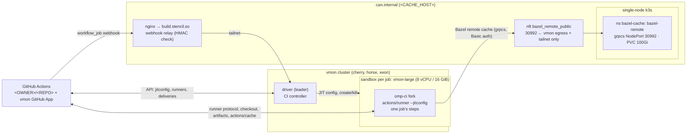

# Self-hosted CI on vmon

Every trusted CI job of `.github/workflows/ci.yml` (pushes to `main`, manual dispatches, releases) runs on **[vibemon](https://github.com/stencil-hq/vibemon) (vmon)**: a job with `runs-on: vmon-large/from=omp-ci` gets its own fresh KVM microVM sandbox, forked from the snapshot of the repo's `omp-ci` template, which runs one ephemeral just-in-time (JIT) GitHub runner and is killed when the job ends. Pull requests run on GitHub-hosted runners, so untrusted PR code never reaches vmon or the shared caches. The only piece of infrastructure this repo operates itself is the shared **bazel-remote** cache on can.internal.

## Architecture

Key properties:

- **One job = one VM.** Each job forks a clean snapshot of `omp-ci`; nothing survives into the next job. A failed job keeps its sandbox for 30 min only when its label carries `/debug`.
- **Warm from the first second.** Toolchains (Rust nightly, bun, bazelisk + Bazel, zig, cmake, ninja, sccache), the bun store, the Cargo registry, Bazel's install base, a fetched output base and the Bazel repository cache (with the xwin splat) are baked into the template from a pinned checkout ([02-omp-ci-template.md](02-omp-ci-template.md)).
- **One shared mutable cache.** bazel-remote holds Bazel action results and CAS blobs; reads are open to the hosts allowed through the node-port filter, writes need the `ci` credentials, which only non-PR jobs receive (repository secrets).
- **Capacity is vmon's.** There is no fixed runner pool: each job holds a `vmon-large` sandbox against the CI team's vmon limits, and jobs over the limit wait in vmon's queue (state `waiting`).

## End-to-end job lifecycle

1. A workflow job with `runs-on: vmon-large/from=omp-ci` is **queued**; GitHub sends a `workflow_job` webhook to the vmon GitHub App's webhook URL, the relay on build.stencil.so.
2. The relay verifies `X-Hub-Signature-256` and forwards the delivery unchanged to the vmon driver over the tailnet.
3. The driver's CI controller checks the label (size `vmon-large`, template `omp-ci`), the repo's installation link (team) and the public-repo policy, then **creates a sandbox** from `omp-ci` in the linked team.
4. It asks GitHub for a **repo-level JIT runner config** with the job's labels and starts `/home/user/actions-runner/run.sh --jitconfig …` as `user` inside the sandbox.
5. The runner picks up the job. Steps run in `/home/user/actions-runner/_work/oh-my-pi/oh-my-pi` with `VMON_CI=1` in the environment; Bazel jobs talk to bazel-remote on can.internal ([04-caching.md](04-caching.md)).
6. On `completed` the driver **kills the sandbox** (and deletes the runner after an idle timeout if no job ever arrived). Missed webhooks are redelivered by the driver's reconcile loop.

## Component map

| Component | What it is | Lives in | Documented in |
| --- | --- | --- | --- |
| vmon CI runners | vmon's GitHub Actions integration: GitHub App, webhook intake, per-job sandboxes, JIT runners | vibemon (operated on cherry/horse/xeon) | [01-vmon-runners.md](01-vmon-runners.md) |
| `omp-ci` template | `ci` (vmon's public runner template) + this repo's toolchains and warm caches | [`infra/vmon/omp_ci_template.py`](../vmon/omp_ci_template.py) | [02-omp-ci-template.md](02-omp-ci-template.md) |
| Cache host | can.internal: single-node k3s `v1.35.5+k3s1`, nginx for build.stencil.so | host | [03-cache-host.md](03-cache-host.md) |
| bazel-remote | `v2.6.2`, TLS + htpasswd, 100Gi PVC, gRPC NodePort 30992 behind an nft source filter | [`infra/bazel-remote/`](../bazel-remote/) | [04-caching.md](04-caching.md) |
| Workflow wiring | `.github/actions/{bazel-cache,bun-install,native-artifacts}` | repo | [04-caching.md](04-caching.md) |

## Redaction & placeholders

Secret **values** never appear in these docs — only key names and placeholders:

| Placeholder | Substitute with |
| --- | --- |
| `<CACHE_HOST>` | The cache host's hostname / SSH target (can.internal) |
| `<PUBLIC_IP>` | The cache host's public IPv4 address |
| `<EXT_IFACE>` | The cache host's public network interface |
| `<TAILNET_IP>` | Tailscale admin IP(s) (the generic CGNAT range `100.64.0.0/10` is kept as-is) |
| `<PUBLIC_SAN>` | The DNS name or IPv4 the vmon runners dial for bazel-remote (`BAZEL_REMOTE_URL`) |
| `<VMON_EGRESS_CIDRS>` | The vmon nodes' egress addresses as seen by the cache host |
| `<OWNER>/<REPO>` | The GitHub repository |

Kept as-is because they are not sensitive: the pod CIDR `10.42.0.0/16`, the service CIDR `10.43.0.0/16`, the CoreDNS IP `10.43.0.10`, in-cluster service names and ports (`bazel-remote.bazel-cache.svc.cluster.local:9092`, NodePort `30992`), and version numbers.

## Reading order

1. **[01-vmon-runners.md](01-vmon-runners.md)** — `runs-on` labels, which jobs run where, the vmon-side setup (GitHub App, team link, public-repo policy, limits), the PR trust split, and operations.
2. **[02-omp-ci-template.md](02-omp-ci-template.md)** — what the `omp-ci` template bakes, and how to build, publish, verify and roll it back.
3. **[03-cache-host.md](03-cache-host.md)** — can.internal: host prep and the single-node k3s cluster bazel-remote runs on.
4. **[04-caching.md](04-caching.md)** — bazel-remote (deploy, endpoint, TLS/auth, exposure, secrets) and every other cache CI uses.
